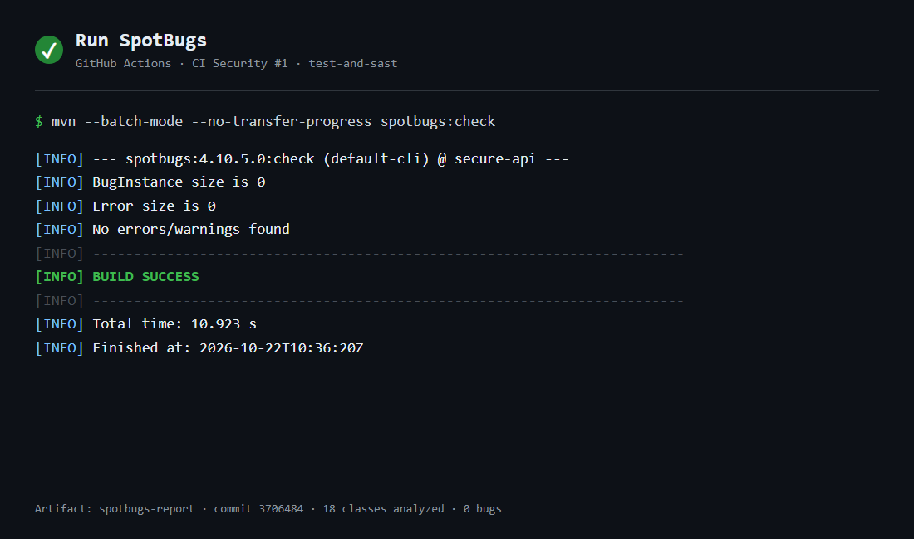
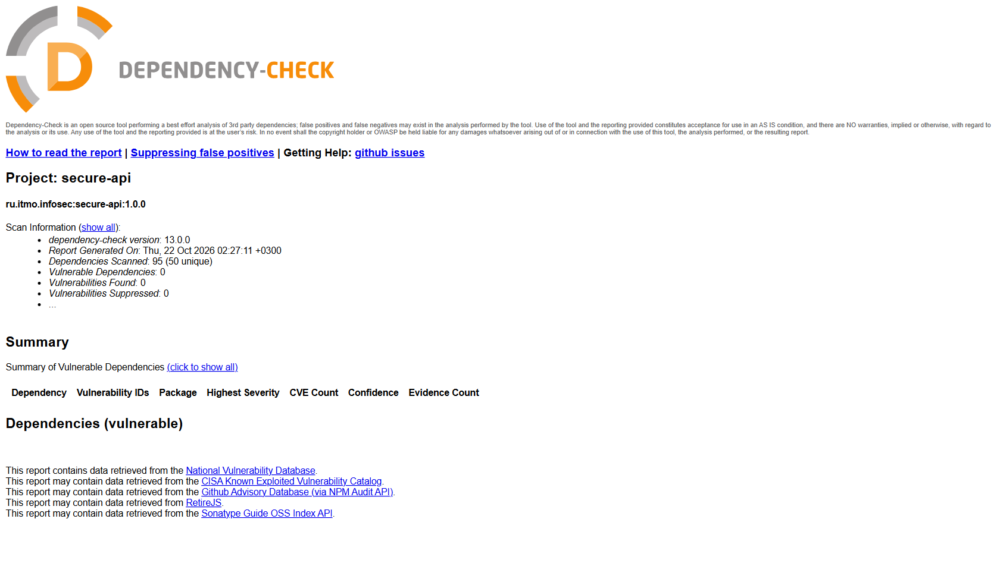

# Информационная безопасность

## Лабораторная работа №1

## Стек

- Java 17
- Spring Boot 4.1
- Spring Web, Spring Security, Spring Data JPA
- H2 Database
- Maven
- SpotBugs и OWASP Dependency-Check

## API

### POST /auth/register

Регистрирует пользователя. Логин содержит от 3 до 32 латинских букв, цифр или символов `_ . -`. Пароль содержит от 12 до 72 символов, строчную и заглавную буквы, цифру и специальный символ.

```json
{
  "username": "student",
  "password": "StrongPass1!"
}
```

### POST /auth/login

Проверяет учетные данные и возвращает JWT со сроком действия 15 минут.

```json
{
  "username": "student",
  "password": "StrongPass1!"
}
```

### GET /api/data

Возвращает записи текущего пользователя. Требует заголовок `Authorization: Bearer <token>`.

### POST /api/data

Создает запись текущего пользователя. Требует JWT.

```json
{
  "title": "Первая запись",
  "content": "Текст записи"
}
```

## Пример проверки через curl

```bash
curl -X POST http://localhost:8080/auth/register \
  -H "Content-Type: application/json" \
  -d '{"username":"student","password":"StrongPass1!"}'

curl -X POST http://localhost:8080/auth/login \
  -H "Content-Type: application/json" \
  -d '{"username":"student","password":"StrongPass1!"}'

curl http://localhost:8080/api/data \
  -H "Authorization: Bearer TOKEN"
```

## Реализованные меры защиты

### SQL-инъекции

Доступ к базе выполняется через Spring Data JPA. Параметры запросов передаются отдельно от SQL, конкатенация пользовательского ввода с SQL-строками не применяется. Интеграционный тест проверяет, что строка `' OR 1=1 --` не позволяет пройти аутентификацию.

### XSS

Поля `title` и `content` проходят серверную валидацию и экранируются с помощью `HtmlUtils.htmlEscape` перед включением в ответ. Политика Content Security Policy запрещает загрузку любого активного содержимого. Тест подтверждает преобразование `<script>` в безопасные HTML-сущности.

### Аутентификация

Пароли хэшируются BCrypt с коэффициентом сложности 12. После входа сервер выдает подписанный алгоритмом HS256 JWT, содержащий идентификатор токена, время выпуска, срок действия и имя пользователя. API не использует серверные сессии. Защищенные методы доступны только с корректным Bearer-токеном.

## Тесты и сканеры

```bash
mvn clean verify
mvn spotbugs:check
mvn dependency-check:check
```

GitHub Actions запускает тесты, SpotBugs и OWASP Dependency-Check при каждом push и pull request в ветку `main`. Dependency-Check использует официальное зеркало NVD проекта OWASP. Отчеты сканеров сохраняются как артефакты запуска.

### Результаты проверки

Статический анализ SpotBugs:



Анализ зависимостей OWASP Dependency-Check:



[Последний успешный запуск CI Security](https://github.com/GoodZerg/infosec-lr1/actions/runs/39764256380)
